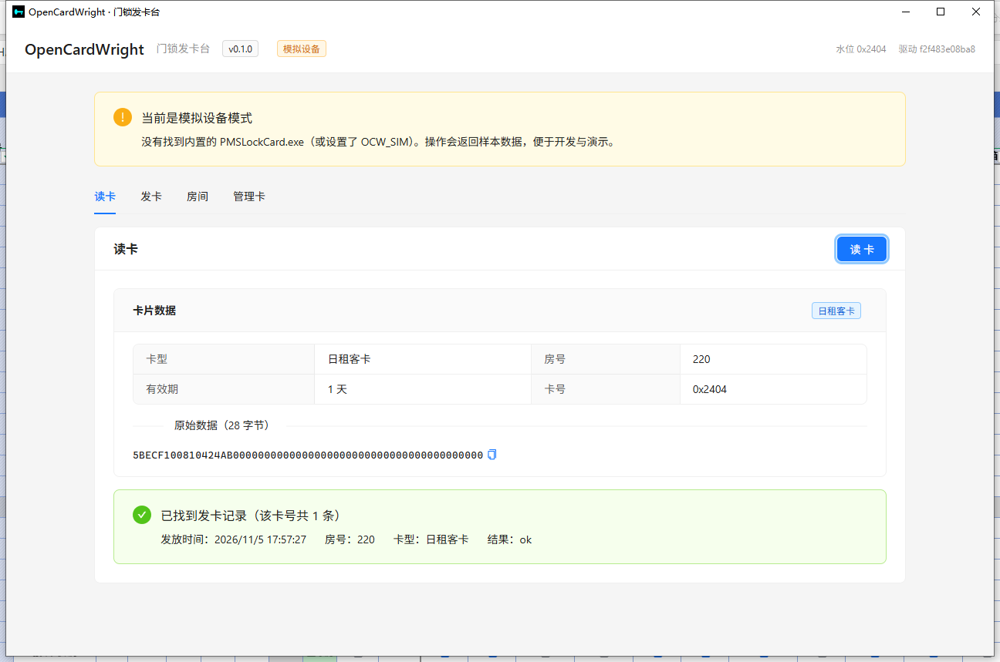
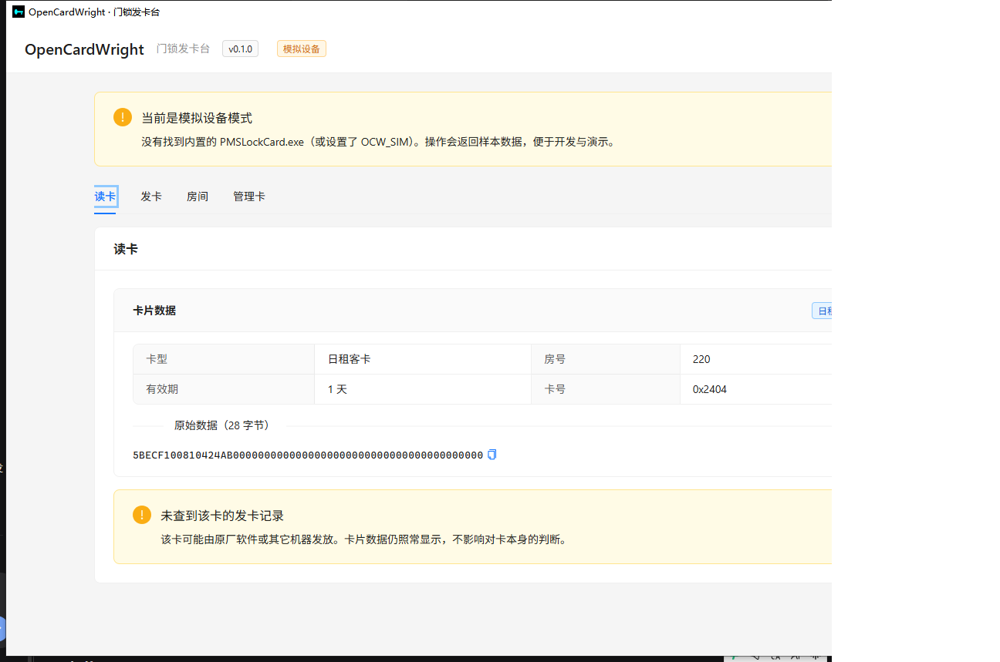
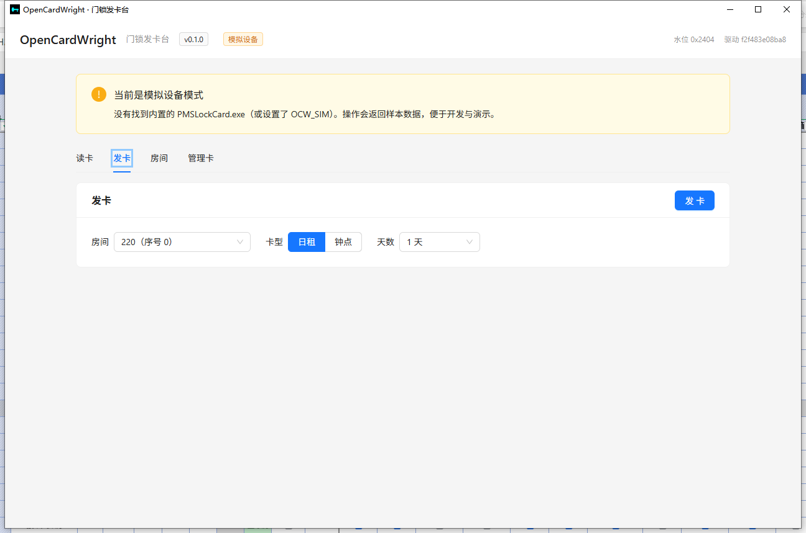
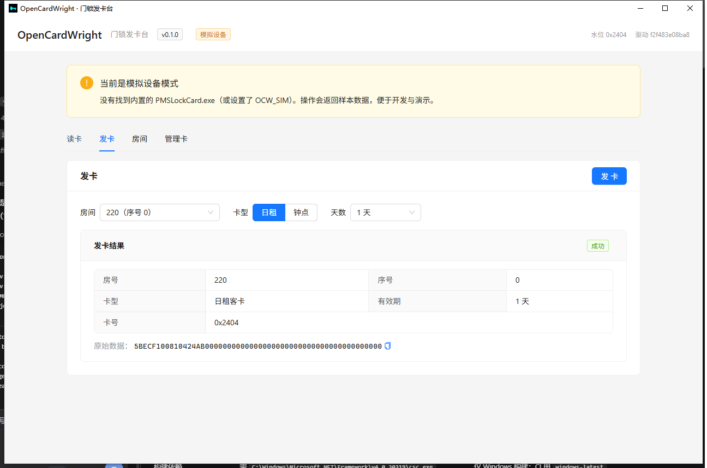
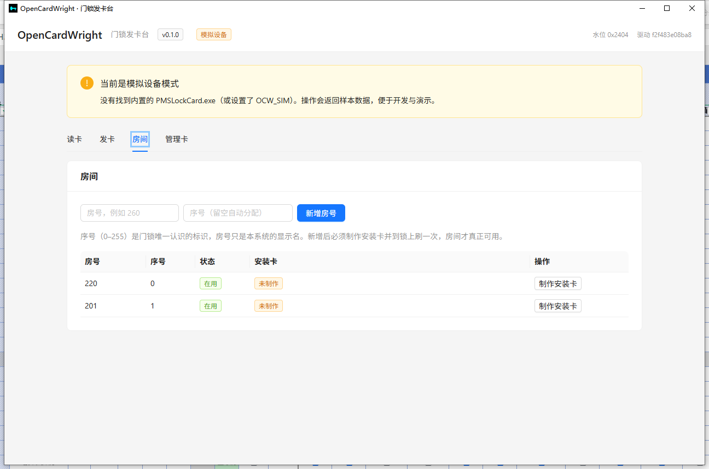
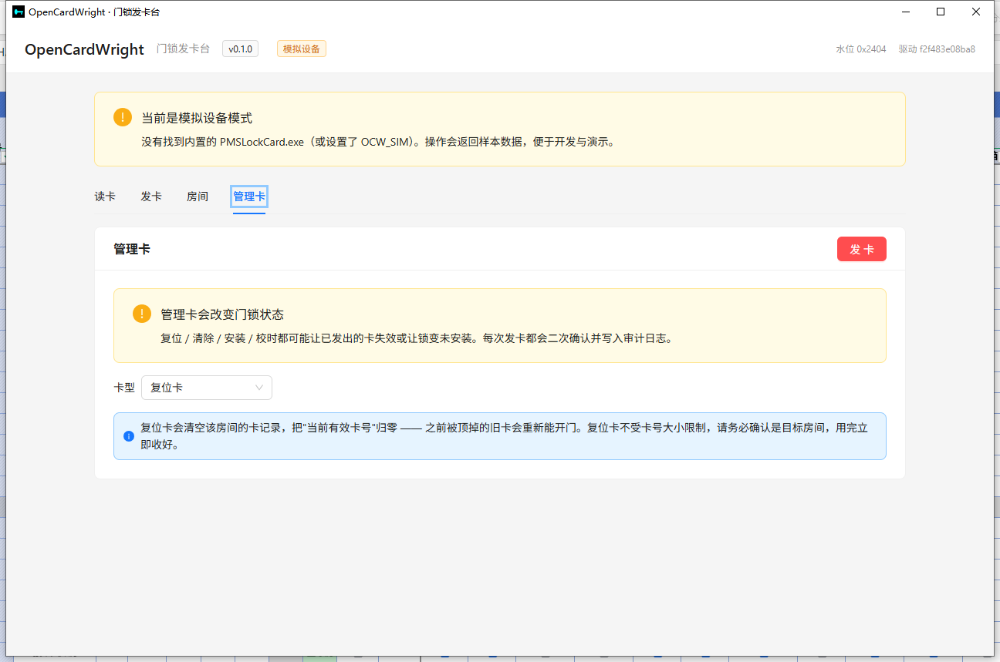

# OpenCardWright

开源的**门锁发卡台**：给中小宾馆/公寓前台用的桌面程序，完成「读卡 → 发卡 → 留痕」，
用于替代已停止维护的智能门锁管理软件 V8.9 中的**发卡**这一环。

> ⚠️ **安全提示**：门锁是人身与财产安全设备。复位卡、清除卡、安装卡一旦误用，
> 可能导致整层楼的卡失效或门锁变"未安装"。管理卡操作请交由受训管理员。
>
> 本产品不修改、不重编译本仓库的 `sdk/`，而是在构建期把它现编成运行时组件，见 §3。

---

## 1. 现在是什么状态

| 阶段 | 状态 |
|---|---|
| M0 地基（工程骨架、构建脚本、CI、SQLite schema） | ✅ **已验证**：SDK 构建 + 27/27 门禁、前端 tsc/vite 通过、`cargo test` 26 项通过 |
| M1 设备通道 + 读卡页 | ✅ 解析器与真机 `selftest` 集成测试通过；读卡页含四态提示 |
| M2 发卡主流程 | ✅ 代码就位（发卡/落库/幂等/水位闸门），**未上真机** |
| M3 管理卡与权限 | ✅ 6 类管理卡 + 原始直写、二次确认、审计落库；⬜ 角色鉴权未做 |
| M4 房号生命周期 | ✅ 新增房间（二级表单）自动分配序号 + 制作安装卡、改房名、逻辑删除；⬜ 初始 ini/CSV 导入 |
| M5 运维 | ✅ 数据库备份 / 恢复（设置 → 备份）；⬜ 诊断包、发卡记录页与 CSV、文件日志轮转 |
| M6 打包发布 | ✅ **NSIS 安装包 1.96 MiB**，静默安装 + 启动 + 27/27 自检全通过；⬜ 代码签名、正式文档 |

已实测通过的命令：

```powershell
npm run build:sdk     # 编译 sdk/ → resources/sdk，跑 27 条黄金向量
npx tsc --noEmit      # 前端类型检查
npx vite build        # 前端产物
- `cargo test --workspace` — **85 项全绿**（解析器 27、真实 selftest 集成 1、模拟构包 2、存储 32、命令层 23）
```

功能规划、验收标准、风险登记见 `../plan/开源门锁发卡软件-建设方案-v0.2.md`；
**未完成项见 `../plan/待办清单.md`**（本页状态表只写「现在能不能用」，不逐条同步）。

---

## 2. 它能做什么（v1 目标范围）

- 读卡：卡型、房号、序号、时长、卡号、28 字节原文；**数据库里查不到也照常显示卡片数据**，只多一行提示
- 发卡：日租、钟点。**客卡最多 62 天 / 62 小时；总控卡最多 63 天 / 63 小时**；再长只能选固定档位
  （90 / 120 / 150 / … / 1095 天，走 `0xC0|月数` 编码）。这条边界来自卡内字节，不是产品随便定的
- 客人信息：发卡时可录入姓名、性别、证件类型、证件号码、民族、出生日期、住址、备注——
  **只存数据库，不写卡**；读卡命中记录时一并显示
- 管理卡：总控、复位、清除、安装、退房钟点、校时、原始直写
- 账号：超管 `admin` 首启设密；管理员可建**用户（admin / frontdesk）**、划分**部门**、重置密码、停用账号。
  密码规则：**8–128 位、必须同时含字母和数字、不能与登录名相同**；设置界面直接列出规则
- 房号：初始导入一次；之后「**新增房间**」走二级表单（房号 / 锁内序号 / 房型），序号留空自动分配，
  新增后**生成安装卡**到锁上绑定；房型支持**自定义标签颜色**（设置 → 房型，新建房型自动配随机色）
- 房号可在**房间抽屉**里改名（序号不变）；重名会被拒绝，该房还有有效卡时也拒绝（先退房再改），
  因为发卡/退房链路都按房号对账
- 房间**格子视图**：每个房间一张卡，按**房态**着色（房型只作中性标签），点卡片直接发卡、改房态、退房。
  **右键房卡选「多选房间」**进入多选模式（进入后才出现勾选框与批量操作栏，点卡片即勾选/取消，
  「全选当前结果」按当前筛选范围），选好房态后一次批量应用，失败会列出具体房号。
  顶部用**房型标签页**筛选（「全部」+ 各房型 + 有未分类房间时多一个「未分类」，数字为房间数），
  右侧的房态下拉（选项带各自房态图标）可与房型叠加
- 房态：空净 / 空脏 / 预定 / 未满 / 已满 / 维修 / 其他，**每种可自定义图标与颜色**（设置 → 房态）
- 退房：顶栏「读卡退房」打开**二级表单**——先点「读卡」把卡读出来核对（卡型、房号、卡号、28 字节原文），
  核对无误再点「确认退房」；没读卡或卡没有卡号时按钮是灰的。房间卡片**右键菜单**（带图标）：
  **发行房间门卡 / 续住写卡** / 持卡退房 / 无卡退房。**持卡退房走的也是上面那个二级表单**
  （会额外校验这张卡是否属于该房间）；无卡退房才是按房间一次作废全部有效卡。
  **非本系统发的卡**（本地没有发卡记录）按卡号退不了，按钮变成「强制退房」并**二次确认**：
  说明会直接写入退房数据（关闭该房全部有效卡 + 改房态），确认后才执行。
  **退房后自动转成哪个房态可在设置里改**（默认空脏房）
- 续住写卡：右键里选，弹窗会显示该房**当前有效期至**，天数默认「剩余天数 + 1」，写一张更长的卡覆盖
- **写卡前必先读卡**：发卡 / 续住 / 安装卡 / 管理卡都会先读一次卡再写；读不到就直接报错
  （"写卡前读卡失败…请先把卡放到读卡器上"），并把原卡信息打到终端（`[write] 写卡前预读：…`）
- 发卡：只在房间卡片右键菜单里进入（抽屉不放发卡），会显示**预计退房时间**，如
  `2026-11-05 21:28 - 2026-11-06 12:00`（日租默认中午退房；按发卡时间估算）
- 房间参数：每个房间可设**最大发卡数**（同时有效的客卡上限，留空=不限），到上限后拒绝发卡并提示
- 卡号治理：**全局统一水位**（所有房间共用一个卡号计数器）；警戒线可在「设置 → 水位」调整，
  到线后顶栏告警提示"给全部门锁刷一遍复位卡"，刷完再在设置里把水位重置到低位
- 到期提醒：按发卡时间估算客卡到期，可设**提前 N 分钟**提醒（默认 30），带**提示声**与顶栏铃铛
- 设备（设置 → 设备，二级页签第一项）：探测串口、切换 COM、跑 27 条自检、看驱动指纹——**dev 模式同样可用**
- 记录与审计：发卡流水、管理卡留痕、CSV 导出、诊断包

**不做**（v1）：房态、入住登记、账务、报表、多门店、自动更新、手机端。这是发卡工具，不是 PMS。

### 界面预览

| 读卡（命中记录） | 读卡（未命中，卡片数据照常显示） |
|---|---|
|  |  |

| 发卡 | 发卡结果 |
|---|---|
|  |  |

| 房间 | 管理卡 |
|---|---|
|  |  |

> 截图是 `OCW_SIM=1` 的模拟设备模式（无读卡器时回放样本），所以顶部有黄色提示条。
> 接真机时把环境变量去掉即可。

---

## 3. 架构

```
React (WebView2)  ──Tauri IPC──▶  OpenCardWright.exe (x64)
                                     ├─ ocw-store   SQLite（rusqlite bundled）
                                     └─ ocw-device  Process.Start
                                                      └─▶ runtime\PMSLockCard.exe (x86)
                                                            └─▶ LC32RFRW.dll → 发卡器
```

**为什么不直接 FFI 驱动**：驱动是 32 位且版本极敏感；把卡格式留在已验证的 .NET 实现里，
产品只做编排与治理。设备层是**子进程 + JSON**，崩溃可隔离、可超时杀、可替换。

---

## 4. 开发环境

| 依赖 | 版本 | 说明 |
|---|---|---|
| Windows | 10 / 11 x64 | 目标平台 |
| Rust | stable（本机 1.99.1） | 需要 `x86_64-pc-windows-msvc` |
| **MSVC 生成工具** | VS Build Tools 2022 + VCTools + Windows 11 SDK | **必需**：没有 `link.exe` 连 `cargo check` 都跑不了 |
| Node.js | ≥ 20（本机 26.13） | 前端与 Tauri CLI |
| .NET Framework | 4.8（系统自带） | 编译与运行 SDK 组件需要 `csc.exe` |
| WebView2 Runtime | 已随 Win11 预装 | Tauri 依赖 |

```powershell
npm install
npm run build:sdk      # 编译 ../sdk 并跑 selftest 门禁
npm run tauri dev
```

打包：

```powershell
npm run tauri build    # 产出 NSIS 安装包
```

### 两个环境坑（本机已踩过，写在这里省时间）

**1. 仓库路径含中文时，MSVC 会报 `D8050`**

```
cl: 命令行 error D8050 :无法执行 c1.dll: 未能将命令行放入调试记录中
```

`cl.exe` 在 `/Z7` 调试信息下处理含非 ASCII 字符的输出路径会失败。绕开办法（二选一，建议都用）：

```powershell
$env:CARGO_TARGET_DIR = 'C:\ocw-target'   # 产物放到纯 ASCII 路径
$env:DEBUG = 'false'                       # 让 cc-rs 不再传 /Z7
```

CI 跑在 `windows-latest` 的 ASCII 路径下，不受影响。

**2. `vite build` 报 `Access is denied`（esbuild 删临时文件失败）**

安全软件会锁住 `%TEMP%` 下 esbuild 刚写的文件。把 TEMP 指到工作区内：

```powershell
$env:TEMP = "$PWD\.tmp"; $env:TMP = $env:TEMP
npx vite build
```

**3. `tauri build` 打包阶段 `failed to bundle project: timeout: global`**

tauri-cli 自带的 NSIS 下载器在本机会超时（同样的 URL 用 PowerShell 下只要两秒）。
先预置工具链缓存，再打包：

```powershell
npm run setup:nsis            # 下载 nsis-3.13 + nsis_tauri_utils.dll，按 Tauri 期望的层级摆好并校验 SHA1
npm run tauri build           # 之后不再联网取 NSIS
```

> 目录层级是坑：工具链要解到 `%LOCALAPPDATA%\tauri\NSIS\` 下**直接一层**
> （`makensis.exe`、`NSIS.exe`、`Bin\` 就在 `NSIS\` 里），不是 `NSIS\nsis-3.13\`。
> 摆错会被判定"缺文件"后删掉重下。脚本里写死了 tauri-bundler v2 的 13 项必需文件与两个 SHA1。

**4. 不要用 `cargo build --release` 出发布版**

那样编出来的是 **dev 壳**：它会去连 `devUrl`（`localhost:5173`），窗口里显示
`ERR_CONNECTION_REFUSED`，因为前端资源没有内嵌。发布/演示一律走：

```powershell
npx tauri build --no-bundle   # 只出可执行文件，不打包
npx tauri build               # 出安装包
```

`Cargo.toml` 里已经补了 `custom-protocol` feature；若确实要手工 `cargo build --release`，
必须加 `--features custom-protocol`。

**5. 设备通信用的是 GBK，不是 UTF-8**

`PMSLockCard.exe` 是 .NET Framework 程序，往管道写的是**控制台代码页**（中文 Windows 上是 GBK 936）。
设备层因此先按 UTF-8 解、失败再退回 GBK；直接用 `read_to_string` 会在遇到中文时整体失败并返回空串，
现场表现就是"设备没有任何输出"。新增设备输出解析时别忘了这条（`crates/ocw-device/src/cli.rs::decode`）。

排查设备问题时可以用现成的探针：

```powershell
cargo run -p ocw-device --example probe -- `
  "$env:ProgramData\OpenCardWright\runtime\PMSLockCard.exe" `
  "$env:ProgramData\OpenCardWright\runtime\LockCard.ini" `
  "$env:ProgramData\OpenCardWright\runtime\IOServer\LC2000" 6 ports
```

它会打印退出码、stdout/stderr 原文和解析结果。

---

## 5. 目录

```
src-tauri/
  src/                  Tauri 命令层与状态
  crates/ocw-device/    CLI 适配、JSON/文本解析、模拟设备
  crates/ocw-store/     SQLite schema 与查询
  resources/sdk/        构建产物（gitignore）
src/                    React 界面
scripts/build-sdk.ps1   编译 SDK + selftest 门禁 + manifest
fixtures/               CLI 输出样本（解析器测试用）
```

---

## 6. 已知限制（务必先读）

1. **打包要先预置 NSIS**：`npm run tauri build` 的 NSIS 阶段会用 tauri-cli 自带下载器，
   在本机会 `timeout: global`。先跑一次 `npm run setup:nsis`（幂等，已就绪会秒退），之后打包不再联网。
   实测产物 `OpenCardWright_0.1.0_x64-setup.exe` 1.96 MiB，静默安装后 `resources/sdk` 完整携带驱动。
2. **图标是占位**：`src-tauri/icons/icon.ico` 是脚本生成的纯色图，发布前应换成正式图标。
3. **未实现**：诊断包、发卡记录页与 CSV 导出、首启向导、初始房间导入、文件日志轮转（逐条见 `../plan/待办清单.md`）。
4. **前端包 1.07 MB**：antd 占大头，尚未做代码分割。桌面端可接受，后续按路由拆。
5. **驱动与应用同包**：若未来出现权利主张，构建时加 `-BundleDriver:$false` 改为首启导入。
6. **总控卡页1 有变体**：SDK 只把 `5B EC F0 FF` 认作总控卡，但真机上见过 `5B EC F1 FF`
   （低 4 位为 1，和钟点卡低4位 0/1 的未解规律同源）。产品侧按 `B3 = 0xFF` 纠正回总控卡，
   并按总控编码换算时长；`sdk/` 未改动。
7. **到期提醒是估算**：卡内只有时长码，没有绝对到期时间；锁实际从"首次刷卡"起算。
   产品按**发卡时间 + 时长**计算，提醒可能比真实到期偏早；月码卡（>62/63 天）的到期日本身也是近似。
8. **输入校验是双端的**：前端给即时提示（`src/utils/validate.ts`、`src/utils/password.ts`），
   后端再校验一次（`commands.rs` 的 `require_text`/`require_login_name`/`require_room_no`、`auth.rs` 的 `validate_password`）。
   密码规则的展示文案在 `src/utils/password.ts`，校验逻辑在 `src-tauri/src/auth.rs`，**改一处必须改另一处**。

---

## 7. 开发约定（踩过的坑，别再踩）

1. **不要用 antd 的命令式弹窗**：`Modal.confirm` / `message.success` 这类静态方法依赖
   `ReactDOM.render`，而 React 19 已移除该 API —— 调用会**静默失效**（按钮点了毫无反应）。
   一律用受控 `<Modal open=...>` 或 `App.useApp()`。管理卡页和房间页就是这么改过来的。
2. **设备输出必须经 `ocw-device::cli::decode`**：CLI 写的是 GBK，直接 `read_to_string` 遇到中文会返回空串。
3. **发布只能走 `tauri build`**：`cargo build --release` 出来的是 dev 壳（连 `localhost:5173`）。
4. **时长边界改一处**：`src-tauri/src/rules.rs` 与 `src/api.ts` 的档位表必须同步。
5. **别把窗口设成置顶**：截图/自动化脚本里用 `SetWindowPos(..., HWND_TOPMOST, ...)` 会把窗口黏在最前面，
   用户只能强关。需要在前台截图时用 `SetForegroundWindow` 就够了，不要动 `WS_EX_TOPMOST`。
6. **写库失败要能回滚**：多步写库（如发卡记录 + 身份信息）先做校验再写，避免半条记录。
7. **改前端走 `npm run tauri dev`**：Vite 会热更新（`[vite] hmr update ...`），不用重新打包；
   只有改 Rust 才会自动重编译+重启（约 10 秒），此时会话失效需重新登录。
8. **看日志，不要看截图猜**：前端 `console.error/warn`、未捕获异常会经 `log_frontend` 转到后端，
   和后端日志一起打在终端（`[frontend][ERROR] ...`、`[guard] ...`、`[rust][PANIC] ...`）。
9. **dev 时密码是 `Test12345`**：`import.meta.env.DEV` 下首启/登录页会预填，发布版为空。
10. **串口用「索引」不是 COM 号**：驱动按 `index + 1` 打开串口，所以 **索引 2 = COM3**。
    `npm run tauri dev` 崩溃若报 `EBUSY ... ~RF*.TMP`，是编辑器保存的临时文件被 Windows 短锁，
    `vite.config.ts` 已把这些临时名加进 watch ignore。
11. **改 Rust 源码前先停 dev**：tauri dev 的 cargo 在编译时会短暂占住源文件，
    这时保存会报 `ReplaceFileW EIO (Win32 1175)`。停掉 dev（或等编译结束）再改。
12. **dev 构建会自动导入房间**：空库启动时读仓库里的 `data/NacreHis.json` 的 `Kf_fh`（客房房号表），
    建 30 个房间 + 房型 + 房态。只在 `debug_assertions` 下编译，发布版不含这段。
13. **模拟设备也会推进卡号**：`OCW_SIM` 下走 `OCWCardBuild.exe`（调用 SDK 的 `CardBuilder` + `CardNoStore`
    离线构包），卡号、房号序号、原始字节都与真机一致，`CardNo.state` 照常自增；区别只是不真的写卡。
    这个构包器由 `scripts/build-sdk.ps1` 从 `tools/CardBuild.cs` 编译，缺了它会退回固定样本。

## 8. 许可

AGPL-3.0，见 `LICENSE`。商用部署、定制、实施服务不受限制；分发修改版须同样开源。
